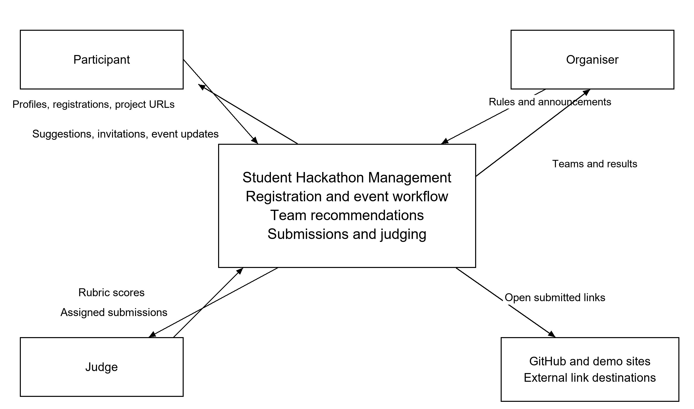
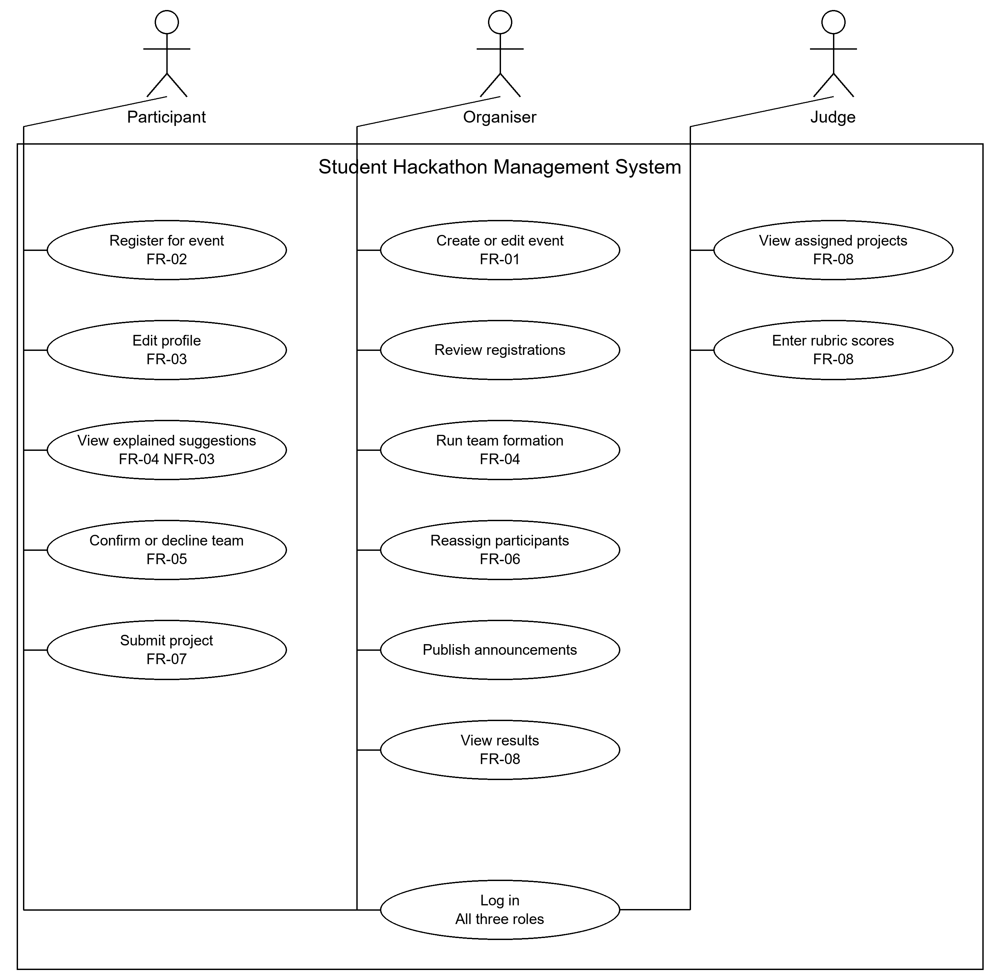
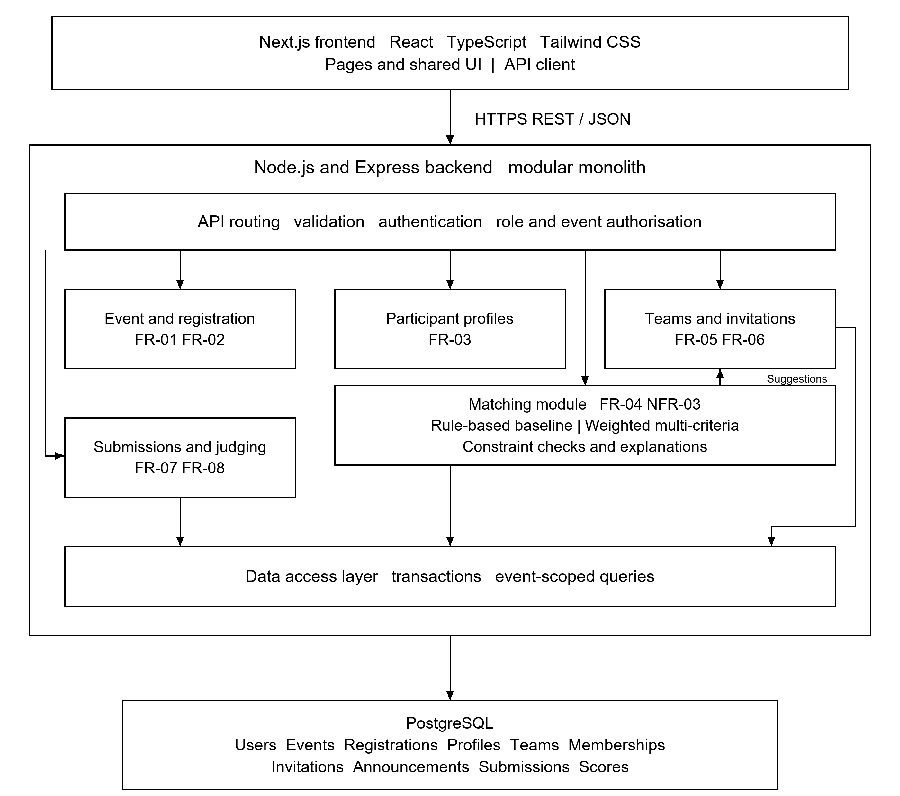

# Architecture and Diagrams

The proposed system is a three-tier web application. A Next.js frontend built with React, TypeScript and Tailwind CSS communicates with a Node.js and Express REST API. PostgreSQL stores event-scoped records. The matching engine is a separate internal backend module with interchangeable rule-based and weighted strategies. The diagrams describe the proposed system design.

## System context diagram

Participants provide profiles, registrations and project URLs. Organisers configure events and team constraints. Judges access assigned submissions and enter scores. GitHub and demo pages are external link destinations; the system stores URLs and does not execute submitted code.

## Use Case Diagram

The diagram shows participant, organiser and judge actions. FR-01 to FR-08 refer to the requirements in Section 6. Login is shared, and protected operations enforce both role and event permissions. Event review and announcements support the event management scope.

## Component Diagram draft

The API validates requests and enforces permissions before invoking domain modules. Matching reads profiles and event constraints and returns suggestions with explanations. Team management applies accepted changes. The data access layer uses transactions to prevent duplicate membership and overfull teams.

Alignment. FR-01 and FR-02 map to event and registration management; FR-03 to profiles; FR-04 and NFR-03 to matching and explanations; FR-05 and FR-06 to invitations and team management; FR-07 and FR-08 to submissions and judging. NFR-01 is enforced by access control, and NFR-02 by responsive frontend pages. Stored entities include users, events, registrations, profiles, teams, memberships, invitations, announcements, submissions and scores.

## Editable diagrams

- [System context SVG](../diagrams/source/01_system_context.svg)
- [Use case SVG](../diagrams/source/02_use_cases.svg)
- [Component SVG](../diagrams/source/03_components.svg)
