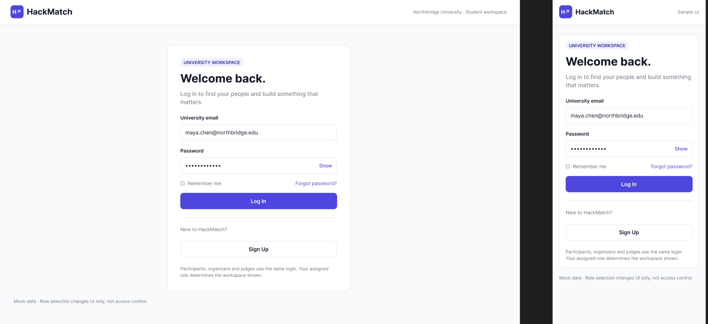
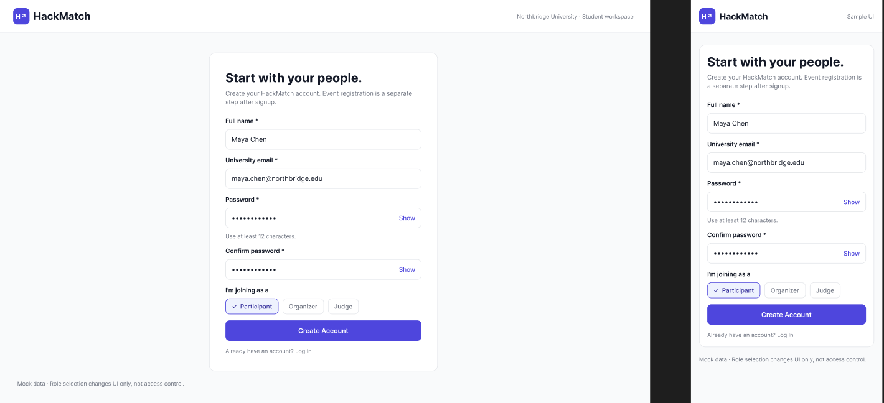
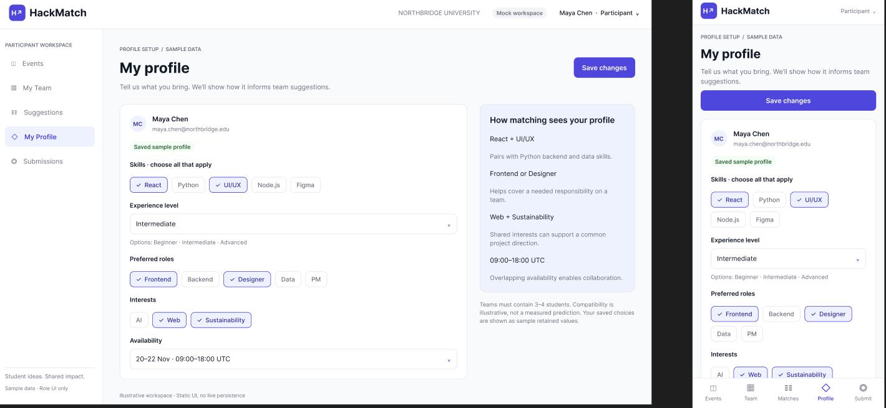
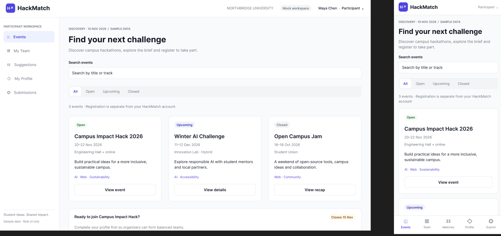
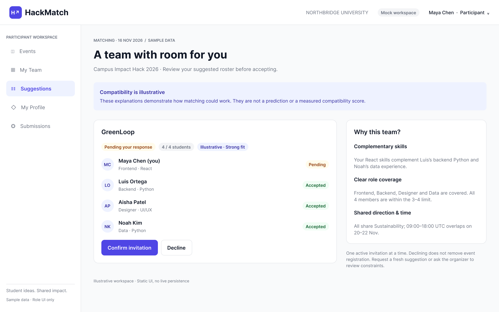
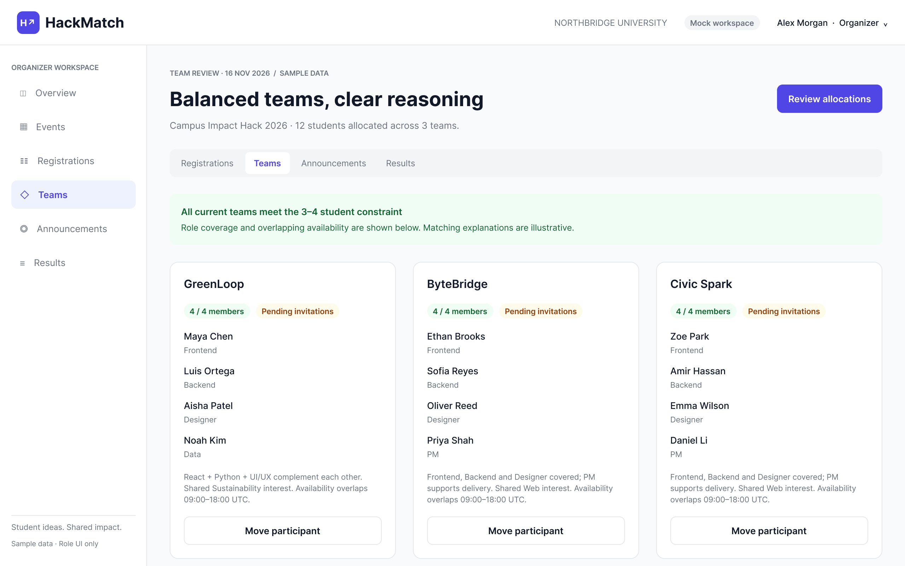
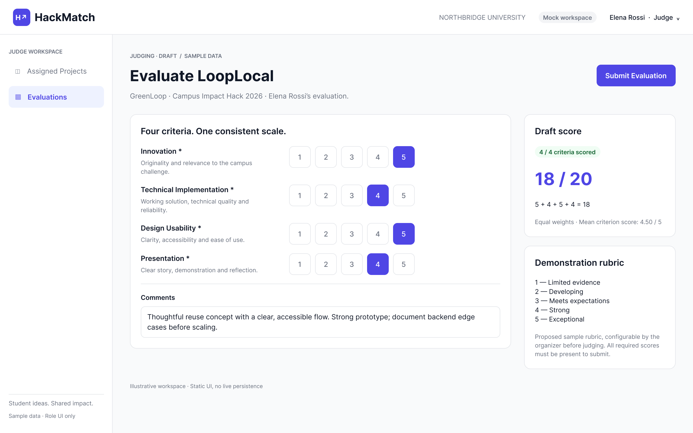

# UX / Prototype

The HackMatch interface prototype presents desktop and mobile layouts for participants, organisers and judges. The main participant scenario is account creation, profile setup, event discovery, review of explained team suggestions and confirmation or rejection of an invitation. The organiser reviews team composition and can reassign participants; the judge evaluates assigned projects using a shared rubric. The mockups use sample data and illustrative matching explanations.

Figma prototype: [HackMatch UI/UX proto](https://www.figma.com/design/bwuI4WpM8lHKXQNkIWr8dK/HackMatch-UI-UX-proto?node-id=0-1)

## 8.1 Login

Participants, organisers and judges use a shared login screen. The interface provides university email and password fields, password visibility, account recovery and access to registration. The assigned role determines the workspace displayed after authentication (NFR-01).

## 8.2 Account registration

The registration form collects a full name, university email, password and password confirmation. Account creation is separate from registration for a particular hackathon. The role selector illustrates the available workspaces; organiser and judge access requires server-side authorisation (NFR-01).

## 8.3 Participant profile

The profile screen collects skills, experience level, preferred roles, project interests and availability. A summary explains how these attributes inform teammate suggestions. Desktop and mobile layouts present the same profile fields and a save action (FR-03, NFR-02).

## 8.4 Hackathon discovery

Participants search events by title or track and filter them by status. Event cards show dates, location or format, a short description and relevant tracks. Opening an event is the entry point to reviewing its rules and registering for participation (FR-02, NFR-02).

## 8.5 Team recommendations and confirmation

The recommendation screen presents a proposed roster, member roles, invitation status and an explanation based on complementary skills, role coverage, interests and availability. The participant can confirm or decline the invitation. The displayed fit label is illustrative and is not a measured prediction of team success (FR-04, FR-05, NFR-03).

## 8.6 Organiser team management

The organiser reviews teams, member roles, pending invitations and compliance with the configured team-size limit. Each team provides a control for moving a participant. The design supports reviewing allocations and making manual adjustments while retaining valid membership constraints (FR-06).

## 8.7 Project evaluation

The judge evaluates an assigned project against four rubric criteria, enters comments and reviews the calculated draft total before submitting an evaluation. The example uses an equal-weight scale from 1 to 5; the visible scores illustrate the interface rather than actual project results (FR-08).

